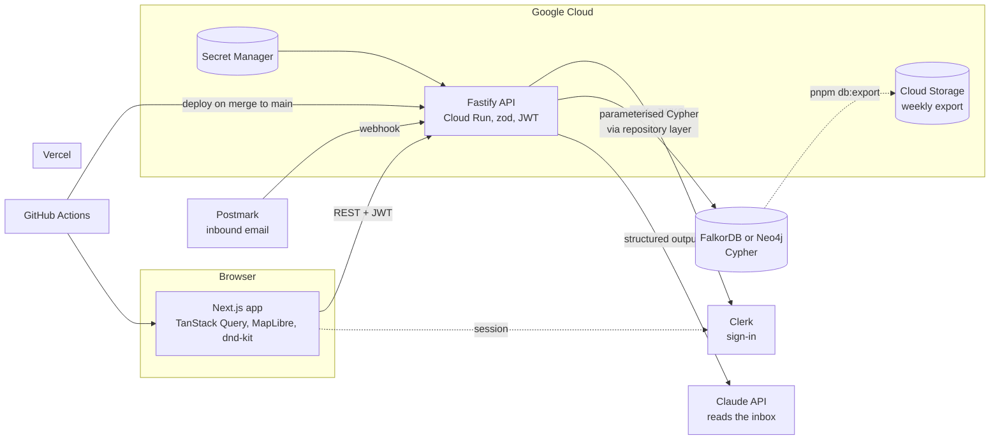
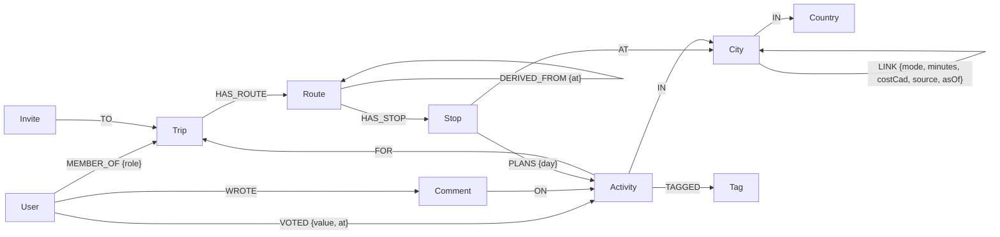

# Trippr: Trip Graph

[](https://github.com/brady29/Trippr/actions/workflows/ci.yml)

A shared trip planner backed by a graph database. A group builds several tagged routes for one trip, and every activity they add belongs to a **place**, not a plan, so it shows up in every route that visits that place.

Version one plans the Asia 2027 graduation trip: 11 stops, 40 nights, 5 to 6 travellers.

> **The modelling decision in one line:** activities belong to places, not plans. A route is an ordered list of stops; each stop points at a shared city; activities hang off the city. Add "Liziba station" to Chongqing once and every route through Chongqing can plan it.

**Live demo:** https://trippr-chi.vercel.app. Choose "Look around the demo" for a read-only tour of the real trip.

## What it does

| | Feature | Where |
|---|---|---|
| 1 | Sign-in, invite links, owner / editor / viewer roles | Trip home → Invite friends |
| 2 | Trips and tagged routes: create, duplicate, rename, tag, mark as current | Trip home |
| 3 | Route editor: drag to reorder, inline nights / travel mode / notes, dates recomputed from the trip start | `/routes/:id` |
| 4 | Shared activity library per city, with planned toggles | Activity drawer, Activities page |
| 5 | Map (solid lines for trains, dashed arcs for flights) and a timeline sized by nights | Route editor |
| 6 | Checks: China visa-free days per entry against 30, number of entries, policy end date, fixed-date events, return date | Route editor |
| 7 | Compare two routes: shared and unique stops, nights per country, activities gained or lost | `/trips/:id/compare` |
| 8 | Votes and short comments | Everywhere an activity appears |
| 9 | *Stretch:* pathfinding over stored train and flight links, including "is there a train at all?" | `/trips/:id/paths` |
| 11 | Live updates and presence: friends' edits appear without a refresh, and you can see who else is looking | Everywhere |
| 13 | *Stretch:* export as text and as a calendar (.ics) | Route editor |
| 14 | Graph explorer: the trip as a 2D knowledge graph (Cytoscape) and on a 3D globe, with hotels, areas, stations, airports and legs as nodes | `/trips/:id/graph` |
| 15 | Booked: every ticket and hotel in one list, what's still to book, and search links into Trip.com, Google Flights, 12Go, Booking.com and Klook filled in with the trip's cities, dates and group size | `/trips/:id/bookings` |
| 16 | Trip inbox: forward a booking confirmation or a TikTok, and Claude adds the ticket, hotel or activity idea to the trip | `/trips/:id/inbox` |

Not built yet: Ask the trip (10) and the full budget layer (12; planned activity cost per route is shown, per-person totals are not). Next up is in [docs/places-map-itinerary-assistant-spec.md](docs/places-map-itinerary-assistant-spec.md): places with map pins, a map tab, a day-by-day itinerary with a calendar feed, and a trip assistant.

## Architecture



The browser never talks to the database. Every read and write goes through the API, which maps the token to a `User` node, checks that user's `MEMBER_OF` role on the trip that owns the resource, and runs parameterised Cypher.

| Layer | Choice |
|---|---|
| Frontend | Next.js 15 (App Router), TypeScript, Tailwind 4, TanStack Query, MapLibre GL JS, dnd-kit |
| API | Fastify 5 + zod, bundled with tsup, Docker image for Cloud Run |
| Database | FalkorDB (default, local Docker) or Neo4j; one repository layer for both |
| Rules | `packages/rules`: pure TypeScript, shared by the API and the browser |
| Contracts | `packages/contracts`: zod request schemas and response types shared by both apps |
| Auth | Clerk session tokens verified against JWKS; the API also signs its own tokens for local sign-in and the demo |
| Inbox | Postmark inbound webhook; Claude (`@anthropic-ai/sdk`, structured output) turns emails and links into legs, stays and activities, applied through the API's own routes as the sender |
| Errors | Sentry on the web app and API (optional; off unless a DSN is set), with request bodies, tokens and query strings scrubbed |
| CI/CD | GitHub Actions: lint, typecheck, unit, integration (both databases), e2e, Docker build; deploy on merge to main |

```
apps/api            Fastify service: routes, auth, repositories, Cypher files
  src/repositories/cypher/<aggregate>/*.cypher   every query, with optional *.neo4j / *.falkordb overrides
apps/web            Next.js app: screens, components, Playwright smoke tests
packages/rules      dates, China entries, fixed-date checks (+ Vitest)
packages/contracts  zod schemas and DTOs
db/schema           one migration file per database
seed                the real trip as JSON; scripts/seed.ts loads it with idempotent MERGE
```

## Graph model



- **Stop** belongs to one route and holds the order and nights. The same city can appear twice in a route.
- **City, Country, Tag** are shared by every route. **Activity** is shared by every route in the trip (the library is per trip: `(Activity)-[:FOR]->(Trip)`).
- **Dates are computed, never stored**: trip start plus the nights before each stop. Reordering needs no data migration.
- Duplicating a route copies its stops, re-links them to the same cities and activities, and adds `DERIVED_FROM` for lineage.
- JSON values (`Activity.when`, `Country.visaRule`) are stored as strings, because Neo4j cannot store maps as properties.

## Three queries explained

**1. Shared activities across routes** ([`routes/library.cypher`](apps/api/src/repositories/cypher/routes/library.cypher)). A route reaches activities two ways: `AT → City ← IN` (everything available in that city) and `PLANS` (what this route chose). Because the activity hangs off the city, a new route through Chongqing sees the same list, votes and comments without copying anything:

```cypher
MATCH (t:Trip)-[:HAS_ROUTE]->(r:Route {id: $routeId})-[:HAS_STOP]->(s:Stop)
      -[:AT]->(c:City)<-[:IN]-(a:Activity)-[:FOR]->(t)
OPTIONAL MATCH (s)-[p:PLANS]->(a)
WITH s, c, a, p IS NOT NULL AS planned
OPTIONAL MATCH (:User)-[v:VOTED]->(a)
WITH s, c, a, planned, sum(coalesce(v.value, 0)) AS votes
...
```

Each `OPTIONAL MATCH` is aggregated before the next one, so votes are never multiplied by tags or comments.

**2. Route compare** ([`compare/cities.cypher`](apps/api/src/repositories/cypher/compare/cities.cypher)). Collect each route's distinct cities, then use list comprehensions for shared and unique stops; nights per country is a separate `sum(s.nights)` grouped by country. Activities gained or lost are a set difference of planned activity ids.

**3. Pathfinding** ([`paths/`](apps/api/src/repositories/cypher/paths)). Travel options are `LINK` edges between cities, one per direction and mode, each with its source and date. Fewest hops uses `shortestPath`; the fastest or cheapest path uses FalkorDB's built-in `algo.SPpaths` weighted by `minutes` or `costCad`. "Is there a train at all?" filters on edge mode, which the built-in algorithm cannot do, so it uses a portable bounded search:

```cypher
MATCH p = (a:City {code: $from})-[:LINK*1..6]->(b:City {code: $to})
WHERE all(e IN relationships(p) WHERE size($modes) = 0 OR e.mode IN $modes)
WITH p, reduce(total = 0, e IN relationships(p) | total + coalesce(e.minutes, 0)) AS total
RETURN ... ORDER BY total LIMIT 1
```

## Trade-offs

- **Why a graph.** The core questions are traversals: which activities can this route reach, what do two routes share, how do I get from Xi'an to Hong Kong by train. The schema is also a clean demonstration of the "shared node, route-specific edge" pattern.
- **FalkorDB vs Neo4j.** Both speak Cypher, so one repository layer serves both. FalkorDB runs free in Docker and has built-in weighted shortest paths; AuraDB Free needs no maintenance but pauses after 72 idle hours. The differences are isolated in a few dialect files (`shortestPath` is only allowed in `WITH`/`RETURN` on FalkorDB; constraints use `GRAPH.CONSTRAINT`) and in the adapters (Neo4j integers). **The same 84 integration tests run against both in CI.**
- **A FalkorDB bug caught by tests.** FalkorDB 4.4 assigned relationship properties to the wrong edges when `MERGE` ran inside `UNWIND` (modes and minutes were shuffled between edges). The integration suite has a regression test, and Compose and CI pin 4.22.1, which fixes it.
- **Computed dates.** Dates come from `rules.ts`, not the database, so reordering is a single write and the rules are unit-tested in isolation. The browser runs the same module, so optimistic edits show the right dates instantly.
- **Optimistic locking.** Every structural write sends the route's `version`; the Cypher only matches when it is unchanged and bumps it. A mismatch returns 409, and the client rolls back and refetches, so two friends editing at once never overwrite each other silently. Edits to one route are queued so each reads the version the last one returned.
- **Gaps in `Stop.order` are allowed.** Order is only used for sorting, so deleting a stop is one statement with no renumbering. FalkorDB has no multi-statement transactions, so every write is a single atomic statement.

## Running it locally

Requires Node 22+, pnpm 9 and Docker.

```bash
pnpm install
```

```bash
cp .env.example .env
```

```bash
pnpm db:up
```

```bash
pnpm db:migrate && pnpm db:seed
```

The seed prints a one-time link that makes the first person to open it the trip's owner. Then start the API (port 8080) and the web app (port 3000):

```bash
pnpm dev
```

Open http://localhost:3000, sign in with your name, and open the owner link from the seed output. Re-running the seed is safe: reference data is refreshed and existing routes are left alone (`pnpm db:seed --force-routes` re-creates them). `pnpm db:reset` wipes the local graph and seeds again.

To use Neo4j instead: `docker compose --profile neo4j up -d neo4j`, set `DB_DIALECT=neo4j` and the `NEO4J_*` variables, then migrate and seed.

## Testing

| Area | Command | What it covers |
|---|---|---|
| Rules | `pnpm test` | Dates across month ends, China entries split by Hong Kong, an event on the arrival day, a 31-day entry flagged, reorders, policy end date |
| API | `pnpm test:integration` | 84 tests against a throwaway graph seeded with the real trip: roles and invites, reorder and 409s, add/edit/remove stops, duplicate, shared library, votes and comments, compare, pathfinding, export, the graph explorer, bookings and the inbox (with a fake reader). Set `DB_DIALECT=neo4j` to run them on Neo4j |
| UI | `pnpm test:e2e` | Playwright: add a stop, reorder, duplicate a route, compare, plan an activity from the library, the graph explorer, booking links, the inbox, phone-width layout |

CI runs all of these on every pull request, plus lint, typecheck and a Docker build of the API.

## Data pipeline

`pipelines/` is a Python 3.12 package (uv, DuckDB, pydantic, pytest) that builds Trippr's place catalogue from open data, following the [Trip Data Platform Spec](docs/data-platform-spec.md). So far it extracts Overture Maps Places for each city's area straight from the public GeoParquet (bounding-box reads, no full downloads), stages it into one `staged_place` schema with normalised names and Trippr's 33-category taxonomy, runs quality checks and writes a run report. Foursquare Open Source Places is wired up but disabled until the owner has access, since its official copies now need an account. Every source's licence and attribution is recorded in `pipelines/sources.yaml`.

```sh
cd pipelines && uv sync
uv run python -m trippr_data run --cities TYO,OSA   # extract, stage, check, report
uv run pytest                                        # offline tests on checked-in fixtures
```

CI runs ruff and pytest for the pipeline; `.github/workflows/data-pipeline.yml` runs it monthly and uploads to Cloud Storage once `DATA_BUCKET` is set. Details in [pipelines/README.md](pipelines/README.md).

## Deploying

Production runs in `us-central1`:

- **Database:** FalkorDB in Docker on a free-tier e2-micro VM (Container-Optimized OS, AOF persistence on the boot disk) with a static internal IP. Port 6379 is reachable only inside the VPC.
- **API:** Cloud Run, reaching the VM through Direct VPC egress (`--network default --subnet default --vpc-egress private-ranges-only`). On startup it retries the database connection while the VM boots, then applies `db/schema` and runs the seed when `DB_AUTO_MIGRATE` and `DB_AUTO_SEED` are on. Both are idempotent: reference data is refreshed and routes are only created once. While the trip has no owner, the startup log prints a one-time "Claim ownership of the trip" link.
- **Web:** Vercel's GitHub integration deploys `apps/web` on every push to main.
- **CI identity:** GitHub Actions signs in to Google Cloud with workload identity federation, so no service-account key exists anywhere.

`deploy.yml` builds the API image to Artifact Registry, deploys it to Cloud Run and checks `/health`. It is skipped until its repository variables exist (listed at the top of the workflow). Its `web` job is only for token-based Vercel deploys and stays skipped without `VERCEL_TOKEN`. `backup.yml` exports the graph to Cloud Storage every Monday.

Production settings:

- **API secrets** (Secret Manager): `trippr-app-jwt-secret` (generated) and `trippr-falkordb-url` (`redis://<VM internal IP>:6379`).
- **API settings** (repository variables): `AUTH_JWKS_URL` and `AUTH_ISSUER` from Clerk (public values), `DEMO_TRIP_ID=asia-2027`, and `WEB_ORIGIN` and `PUBLIC_WEB_URL` set to the Vercel URL. `AUTH_DEV_LOGIN` must stay off; the API refuses to start with it on in production.
- **Web** (Vercel environment variables): `NEXT_PUBLIC_API_URL` and `NEXT_PUBLIC_CLERK_PUBLISHABLE_KEY`. `CLERK_SECRET_KEY` is optional; without it Clerk runs client-side only and the Next.js middleware stays off.

## Decisions on the open questions

| Question | What the code does now |
|---|---|
| Production database | Both work; FalkorDB is the default. Pick one when deploying (`DB_DIALECT`). |
| Clerk or Auth.js | Clerk. The API verifies Clerk tokens via JWKS and the web app uses Clerk when its keys are set. Live in production. |
| Separate API or route handlers | Separate Fastify API, as in the spec. |
| Accounts for friends | Everyone signs in; an invite link adds them with a role. |
| Library per trip or global | Per trip (`(Activity)-[:FOR]->(Trip)`), so strangers' trips never leak into yours. |
| Live presence | Built: server-sent events from the API, one Cloud Run instance. |
| Budget layer | Partial: planned activity cost per route in CAD. |
| Domain | Not chosen. |

## 90-second demo script

1. Open Asia 2027 and show the two routes, "Main" and "With Shanghai".
2. Compare them: shared stops, unique stops, nights per country.
3. Add an activity in Chongqing and show it appearing in every route through Chongqing.
4. Move Chongqing earlier: the dates shift and the China entry counter updates.
5. Ask "is there a train from Xi'an to Hong Kong?" on the Paths page.

## Security

See [SECURITY.md](SECURITY.md) for how to report a problem. CI scans every push for committed secrets.

## License

[MIT](LICENSE) © 2026 Brady Walintschek. The bundled IBM Plex fonts are under the SIL Open Font License ([apps/web/src/app/fonts/OFL.txt](apps/web/src/app/fonts/OFL.txt)).
