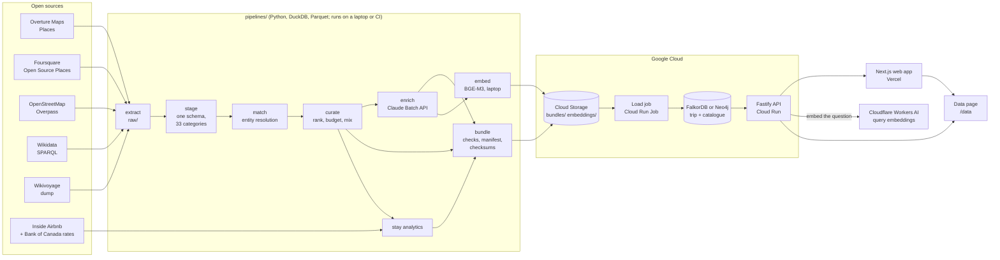
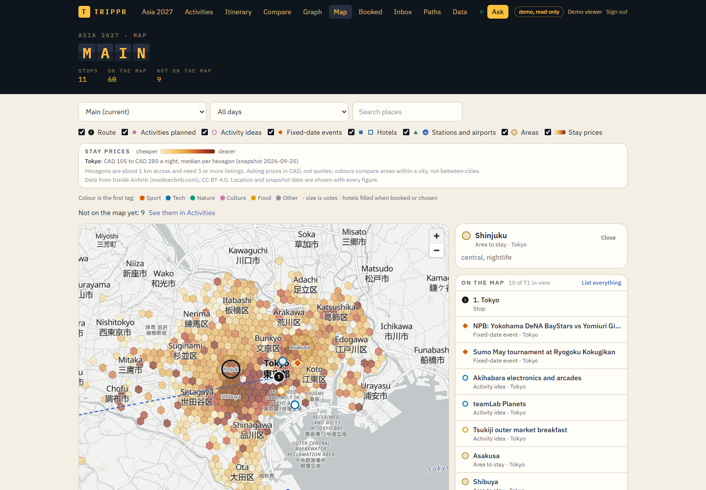
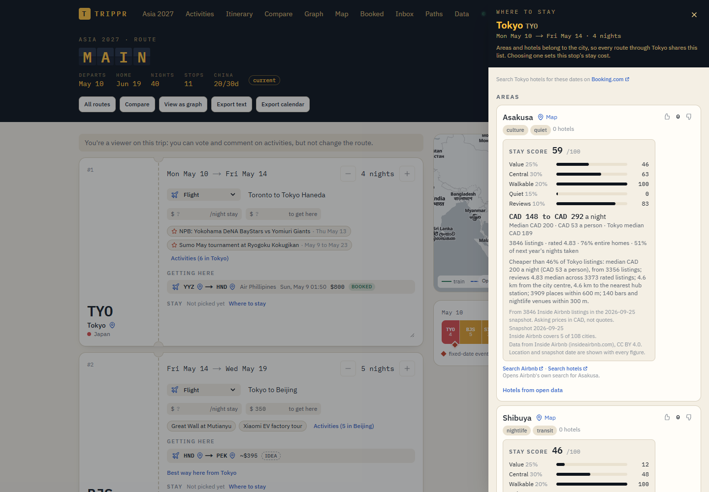
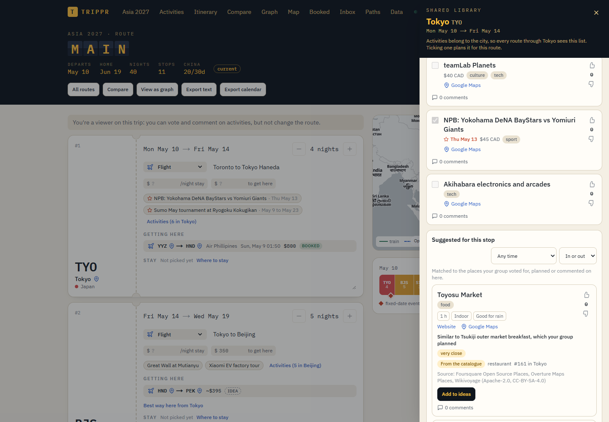
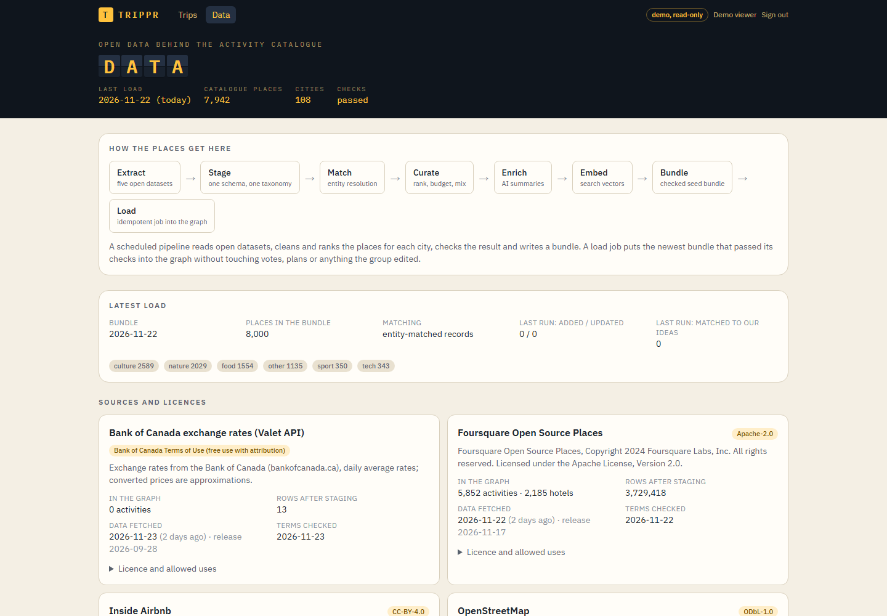

# Trippr case study: a group trip planner on a graph, and the data platform behind it

Nov 25, 2026 · live at https://trippr-chi.vercel.app · data page at https://trippr-chi.vercel.app/data · code in this repository

This is the write-up of how Trippr's data platform was built, what it measured, what it cost and where it falls short. If you have five minutes, read "The short version" and "What went wrong". Everything else is there to check the claims.

## The short version

- **The problem.** Five or six friends plan a 40-night trip through Asia. They want several candidate routes that share the same places, and thousands of real things to do in 108 cities, not a few hundred typed-in ideas. Trip data is graph-shaped (routes, stops, cities, activities, votes). Place data is a mess: the same temple appears in five datasets under different names, scripts and coordinates.
- **What was built.** A graph-backed trip planner (Next.js, a Fastify API, FalkorDB or Neo4j) and, beside it, a Python data pipeline that extracts five open datasets, merges them into one place catalogue, ranks and picks 8,000 places, enriches them with an LLM, embeds them for search by meaning, adds stay analytics from Inside Airbnb, and ships the result as a checked bundle that a load job merges into the graph without touching anything the group has done.
- **What was measured.** 6.1 million source records resolved to 5.2 million places; entity-matching precision 95.1% and recall 85.0% on 383 labelled pairs; a Haiku against Sonnet comparison before spending money; a search model chosen by a labelled query set (MRR 0.68 against 0.52 for the cheaper model); and a real run that enriched 7,531 of 8,000 places for about $0.65.
- **What is not finished or not proven.** The matching labels were not reviewed by a second person and the threshold was tuned on them. OpenStreetMap covers 2 of 108 cities. Inside Airbnb covers 5 of 108. 469 places have no enrichment. Flight prices are sparse. The search eval against the loaded graph has not been run. Recommendations shipped, but they were only evaluated offline on simulated groups, and the diversity settings look too strong on real vectors (see "Recommendations").

## The problem

**Graph-shaped trip data.** A route is an ordered list of stops; each stop points at a shared city; activities hang off the city, so an idea added once is visible in every route through that city. Questions the group asks are traversals: what do two routes share, which activities can this route reach, is there a train from Xi'an to Hong Kong. That is why the trip is stored in a graph (see the [README](../README.md) for the model and three of its queries).

**Messy place data.** There is no single good source of "things to do in Osaka". Overture Maps and Foursquare are huge and noisy (most rows are restaurants, shops and offices). OpenStreetMap, Wikidata and Wikivoyage are small and good at the famous places. Each has its own categories, name fields, coordinates, licence and failure modes. The work is making them one table you can trust, and being able to say where every row came from and under what licence.

**Constraints that shaped the design.**

| Constraint | Consequence |
|---|---|
| The graph database runs on a free-tier VM with 1 GB of memory | The graph holds a curated 8,000 places, not millions |
| The API runs with 512 MiB | No embedding model in the API; place vectors are computed on a laptop and only the short query is embedded by a hosted service |
| A personal project with no budget | Every paid step is costed before it runs and capped (`ENRICH_BUDGET_USD`); nothing is scraped; everything is open data or an official API |
| A real group uses it | Loading new data must never change votes, plans, comments or hand edits |
| Mixed licences (ODbL, CC BY-SA, CC BY, CDLA, Apache) | Every place keeps its source records and their licences, and the Data page shows them |

## Architecture



Only the load job writes catalogue data into the graph, and the browser never talks to the database: every read goes through the API, which checks the caller's role on the trip first.

**Repository layout.** `apps/api` (Fastify, repositories, Cypher files per dialect), `apps/web` (Next.js), `packages/contracts` (zod schemas shared by API and web), `packages/rules` (pure TypeScript rules shared by both), `pipelines/` (the Python data platform), `db/schema` (one schema file per database), `seed` (the real trip as JSON).

## Data flow and idempotency

```
extract -> raw/<source>/<date>/        exactly as received, with a _meta.json (licence, query, rows, checksum)
stage   -> staging/<date>/             one staged_place schema, normalised names, Trippr's 33 categories
match   -> matched/<date>/             links.parquet + golden.parquet (one record per real-world place)
curate  -> curated/<date>/             score, per-city budget, category mix
enrich  -> enriched/<date>/            LLM fields, cached by content hash
bundle  -> bundles/<date>/             places, enrichment, stay tables, sources.json, manifest.json (SHA-256 of every file)
embed   -> embeddings/<date>/          place vectors, uploaded beside the bundle
load    -> graph                       newest bundle that passed its checks
```

Every stage writes a dated folder and can be re-run on its own. A failed check fails the bundle, so the app keeps the last good data.

**What the load job does:**

- New catalogue places become **ideas** on the trip's library; they are never planned for anyone.
- A place already in the graph (same id, or sharing a source record) is refreshed in place. Each place carries a content hash, so running the same bundle twice changes nothing.
- A hand-written activity that is the same place (same city, same name, within 500 m if pinned) keeps its id, votes, comments, plans, title and tags; only its empty fields are filled.
- A place the newer bundle drops is removed if nobody used it, and otherwise kept and marked "no longer listed".
- A catalogue place someone deletes in the app is hidden, so the next load does not bring it back.
- It writes a `DataLoad` node (bundle date, counts, check results) that the Data page shows.

**What the load job never touches:** votes, comments, plans, trip and route data, a title or website someone edited, a pin placed by hand, the group's own hotels, stays and bookings, Area text, and an activity's own summary (the AI summary is only added while the activity has none). Catalogue hotels have no trip, so the hotel list, votes and bookings never reach them. A bundle without enrichment, embeddings or stay data leaves whatever the graph already holds.

**Vectors have their own guard.** The loader refuses a run from a different model family or size and loads nothing (a `--rebuild-index` flag is the explicit way to change model), because a query vector from a different model is noise (below).

## The stages, each with its key decision

### Extract and stage

**Decision: read remote Parquet by bounding box instead of downloading datasets.** DuckDB reads Overture and Foursquare straight from public cloud storage, fetching only the row groups inside each city's box (25 km radius for big cities, 10 km for small ones). The full Overture run took about 37 minutes on a home connection for 6.8 million rows (560 MB of raw Parquet); nothing is downloaded in full. **Trade-off:** results depend on the release being read, so the release is recorded in the source metadata.

**Decision: map every source to one staged schema and a fixed 33-category taxonomy, with the mapping as checked-in CSVs.** A change to what counts as a "temple" shows up in a diff. Names are Unicode-normalised but the local-script and English names are kept separately, because matching Japanese or Thai names needs them. **Trade-off:** the 33 categories are coarse, and each source's own labels are lost except in `category_source`.

Staging drops duplicate ids, closed places, places outside every city's radius, country mismatches and unnamed rows, and counts each drop in the run report.

| Source | Raw rows | Staged rows | Notes |
|---|---:|---:|---|
| Overture Maps Places (release 2026-11-18.0) | 6,821,810 | 2,276,026 | 60.3% of in-city rows excluded on purpose (offices, clinics, most shops) |
| Foursquare Open Source Places (2026-11-17) | 13,560,332 | 3,729,418 | 40.9% excluded; 28.2% had no category at all |
| OpenStreetMap | 78,096 | 66,104 | **Tokyo and Guangzhou only** |
| Wikidata | 25,978 | 22,448 | 108 cities; items of mapped classes with at least one sitelink |
| Wikivoyage (dump 2026-11-01) | 20,660 | 10,867 | 108 cities; 443,714 listings in the whole dump |
| **Total staged** | | **6,104,863** | |

Source: `pipelines/out/reports/2026-11-22.md` and `matched/2026-11-22/match.stats.json`. Staging took about 3 minutes for the Overture rows. Overture's unmapped share was 7.0% on the first full run, almost all rows with no category or only a top-level one.

**OpenStreetMap is the honest gap.** The public Overpass servers answered 502/504 for most of the extraction. The extractor queues politely, waits for a free slot, retries with backoff, falls back to a second instance and caches finished groups, but only Tokyo and Guangzhou completed. The pipeline is built so that re-running `extract --source osm` later fills in the rest and nothing else changes; Geofabrik extracts are the documented alternative. Until then OSM is cited by only 280 of the 8,000 curated places.

### Match (entity resolution)

**Decision: a hand-weighted pairwise score with blocking, strong links first, then union-find with a spread guard.** Comparing 6.1 million records pairwise is impossible, so only records from different sources in the same or neighbouring geohash-7 cells (about 150 m), within 500 m, with compatible category families are compared. Then:

1. Strong links: a shared Wikidata QID, or a shared website host within 300 m. A QID or website used by four or more places of one source is a chain, not an identity.
2. Scored pairs: `0.55 name + 0.30 distance + 0.15 category`, with a bonus for a matching phone or address, accepted at 0.82 with a name similarity of at least 0.6. Name similarity is the best over every name variant of Jaro-Winkler and a token-set measure weighted by how rare each token is in the city (so "coffee" and "店" count for little). CJK, Hangul and Thai names are compared as character bigrams.
3. Pruning, then union-find, refusing any merge that would make a cluster wider than 500 m.

**Trade-off:** prefer a missed match to a false merge. A false merge hides a real place from the group; a missed one just shows it twice. A learned model (logistic regression on the labelled pairs) is the documented next step if hand weights stop being enough.

| Result | Value |
|---|---:|
| Records in | 6,104,863 |
| Places out (clusters) | 5,229,009 |
| Places confirmed by more than one source | 761,498 (14.6%) |
| Places confirmed by three or more sources | 34,037 |
| Places that include an OSM, Wikidata or Wikivoyage record | 92,196 (39,172 exist only there) |
| Run time | 111 minutes on a laptop (Tokyo alone: 40 minutes, 93 million candidate pairs) |

**Precision and recall, and how far to trust them.** 408 candidate pairs were sampled from the blocking step in six cities (Kyoto, Shanghai, Busan, Hanoi, Chiang Mai, Taichung), stratified by the matcher's own confidence so both easy and borderline pairs are in. 383 got a yes or no label; 25 were marked unsure and left out. At the chosen threshold of 0.82:

| | Value |
|---|---:|
| Labelled pairs used | 383 (160 true matches) |
| True positives / false positives / false negatives | 136 / 7 / 24 |
| **Precision** | **95.1%** |
| **Recall** | **85.0%** |
| At the starting threshold of 0.78 | 94.1% precision, 90.0% recall |
| Weakest city (Hanoi) | 88.2% precision, 83.3% recall |

**The caveat that matters.** The labels were written by the pipeline's author, by reading each pair's names, categories, addresses, websites and distance. They have not been reviewed by a second person. The threshold was chosen by sweeping it over those same pairs, so the two numbers are the best the sweep found, not an independent test; the spec's targets (95% precision, 85% recall) were hit almost exactly, which is exactly what tuning on your own labels would produce. The pairs also contain no OSM records (OSM was not extracted for those cities when they were sampled), most are Foursquare against Overture, and recall is measured only among pairs that blocking generates, so a true match more than 150 to 300 m apart is never counted. Read these as "the matcher is plausible", not "the matcher is 95% precise on Asia's places".

### Curate and bundle

**Decision: rank, then pick 8,000 places with a per-city budget and a category mix.** The score adds sources agreeing, the log of Wikidata sitelinks, a Wikivoyage listing, best source confidence and a category weight (sights outrank chain cafes), plus a small website bonus, minus a chain penalty. A city's share of the 8,000 is proportional to `log(1 + eligible places) x (1 + nights / 5)`, where nights is what the real routes spend there, clamped to a floor of 20 and a cap of 300. Each colour tag gets a target share inside a city.

**Why the mix exists.** The staged pool is 76.3% food (restaurants alone are 2.9 million of 6.0 million staged Overture and Foursquare rows; culture is 9.1%, other 7.6%, tech 3.5%, nature 3.0%, sport 0.6%). A trip planner whose catalogue is three quarters restaurants is useless. With the mix:

| Colour tag | Staged pool (6.0M Overture and Foursquare rows) | Curated 8,000 | Target |
|---|---:|---:|---:|
| food | 76.3% | 19.4% | 20% |
| culture | 9.1% | 32.4% | 30% |
| nature | 3.0% | 25.4% | 25% |
| other | 7.6% | 14.2% | 15% |
| tech | 3.5% | 4.3% | 5% |
| sport | 0.6% | 4.4% | 5% |

The pool column is the first-run staging report; what curation would have picked with the mix switched off was not recorded. **Trade-off:** the targets are a judgement about what a sightseeing group wants, set in `config/curation.yaml`, and they push down good restaurants in a food city; a user cannot tune them.

The 8,000 places come from 4,711,892 eligible candidates across 108 cities (Tokyo gets 231, Beijing 238; the smallest cities get 30 to 35). Sources cited by the 8,000: Overture 6,163, Foursquare 5,852, Wikivoyage 3,771, Wikidata 3,106, OSM 280.

**The bundle is the contract.** `bundle` writes `places.jsonl.gz` and Parquet, `enrichment`, stay tables, `sources.json` and a `manifest.json` with SHA-256 checksums, counts and every check result. The schema is defined twice, in pydantic and in zod, and the golden test writes a bundle from fixtures and commits it; the Python tests, the TypeScript contract tests, the API integration tests and the end-to-end tests all read that same file, so the two sides cannot drift. Bundle checks include unique ids, a licence for every source record, coordinates inside the city radius and the country's box, no two places with the same name within 50 m, the budget and the colour-tag mix. A failing bundle is never loaded. The check earned its place: the first bundle from the match output **failed** with three pairs of same-name places within 50 m (an earlier staged-row bundle had five); curation now folds a pair the match stage missed into the better-scored place, and the bundle then passed.

### Enrich (LLM)

**Decision: choose the model with an eval, and cap the spend before it starts.** Each curated place gets tags (from the fixed taxonomy), a one-line summary (at most 140 characters, written only from the source text), typical duration, best time of day, indoor or outdoor, price level, and a suggested display name for records whose own name is generic ("Tokyo, Japan"). It runs on Claude's Message Batches API (half price), with a strict JSON schema, a cached shared system prompt, results cached by a hash of exactly what the model saw, a resumable state file for every batch, and a cost guard: nothing is submitted over `ENRICH_BUDGET_USD` (default 25) and nothing at all without `--yes`.

**The eval set** is 174 hand-labelled places in 17 countries and 9 scripts (12 are deliberately formal or city-named records). The target is 0.85 tag F1, at most 2% unsupported summaries (checked by rules and by a second model call with a rubric), and at least 98% valid answers. 174 places is short of the 200 the spec asked for; one person's labels; duration is scored within 30 minutes for that reason.

| | Haiku (`claude-haiku-5-5`) | Sonnet (`claude-sonnet-5-5`) |
|---|---:|---:|
| Valid answers | **100.0%** | 94.8% (9 of 174 gave none) |
| Tag F1 | 0.857 (precision 85.8%, recall 85.6%) | 0.858 (precision 82.4%, recall 89.4%) |
| Duration within 30 min | 85.5% | **89.1%** |
| Best time of day | 57.0% | **73.9%** |
| Indoor or outdoor | **93.7%** | 86.5% |
| Unsupported summaries, rule check | **0.0%** | 0.6% |
| Unsupported summaries, judge | **0.6%** | 1.2% |
| Display-name match | **100%** | 33.3% |
| Cost per 1,000 places (batch rates) | **$0.05** | $0.88 |
| Meets the targets | **yes** | no (valid answers 94.8% under 98%) |

Haiku was chosen: the same tag F1 at about one seventeenth of the cost, and it returned a valid answer every time. The table is not one-sided: **Sonnet is clearly better at best time of day (73.9% against 57.0%)** and slightly better at duration, and Haiku's 57% there is the weakest number in the whole enrichment, which is why the app shows duration, best time and price level as estimates on hover. Tag F1 of 0.86 only just clears the 0.85 target on 174 places, so a difference of a point or two between models is noise. Per-script and per-country tables (CJK 0.87, Hangul 0.81, Thai 0.85; Chinese places 0.85) are in `pipelines/out/enrich-eval/*/report.md`; the small scripts have 1 to 15 places each and are hints only.

**The full run (2026-11-24).**

| | |
|---|---:|
| Places in the bundle | 8,000 |
| Distinct requests (identical content shares one answer) | 7,975 |
| Answers accepted | 7,506 (covering 7,531 places) |
| Places left without enrichment | 469 |
| Places with an AI summary | 6,516 |
| Batches | 6 (four first-pass batches of about 2,000, then two retry batches) |
| First pass: accepted / rejected | 6,977 / 998 |
| Retry 1 of the 998 | 391 accepted, 607 rejected |
| Retry 2 of the 607 | 138 accepted, 469 rejected |
| Batch spend, from the state file | $0.65 (first pass $0.54) |
| Estimate before submitting (first pass) | about $1.76 |

**What went wrong in the run.** 468 of the 469 failures are the same thing: the model wrote a summary longer than the 140-character limit, and the validator rejects it rather than truncating (a cut-off sentence is worse than none). The eval had not shown it (100% valid on 174 places with short descriptions); real places with Wikivoyage text tempt longer sentences. Retrying helped only for some, because the same input tends to get the same long answer, and after three attempts a key is parked until its input or the prompt changes. The 469th failure hit the token limit. Those 469 places (5.9% of the bundle) simply have no AI fields and load as ordinary catalogue places. A tighter prompt ("at most 120 characters") or one retry with the length stated is the obvious fix and has not been done. A further 1,015 enriched places have tags and duration but no summary (the prompt says to leave a field empty instead of guessing).

**What is AI-written in the product.** The summary, tags, duration, best time, indoor flag, price level and "good for" fields on a catalogue place. Every summary is shown with a label from the data ("Summary written by AI from Wikidata and Wikivoyage"). The bundle check `enrichment.summary_provenance` fails the bundle if any summary lacks its AI marker, label or provenance (model, prompt version, date, input sources), and the load job refuses such a bundle again on its side. A hand-written activity keeps its own summary; the AI never overwrites a person. Names are never changed (a suggested display name is a subtitle). Separately, the trip inbox uses Claude to turn a forwarded booking email into a ticket or hotel entry that the group then sees and can edit.

### Embeddings and search

**Decision: a hybrid. Compute place vectors on a laptop, embed only the query in the cloud, and make sure both sides are the same model.** The API runs in 512 MiB and cannot load even the smallest model. Computing 8,000 vectors on a laptop is cheap, so the only runtime need is embedding a question of a few to 30 tokens.

**The model was chosen by a labelled query set** (89 queries over the real 8,000-place bundle: 41 place names, 24 categories, 12 intents, 12 descriptions, in English, Chinese, Vietnamese, Japanese, Korean and Thai; labels are rules over the bundle's columns, so they survive a re-curation). Brute-force cosine, 4 CPU threads on a Windows laptop:

| Model | Dims | MRR | Recall@10 | Place embedding time (8,000) |
|---|---:|---:|---:|---:|
| Hashing baseline (lexical) | 384 | 0.201 | 0.178 | seconds |
| `paraphrase-multilingual-MiniLM-L12-v2` | 384 | 0.355 | 0.220 | about 5 min |
| `multilingual-e5-small` (ONNX fp32) | 384 | 0.517 | 0.386 | 4.6 min |
| `multilingual-e5-base` | 768 | 0.594 | 0.431 | 16 min |
| `bge-m3` (PyTorch) | 1024 | 0.673 | 0.558 | 53 min |
| **`bge-m3` (ONNX 8-bit)** | 1024 | **0.680** | **0.563** | 24 min |

**Why BGE-M3.** It beats the cheapest multilingual model by 30% in MRR and 45% in recall@10, almost all of it on Chinese (MRR 0.81 against 0.17), Japanese (0.41 against 0.17), Vietnamese and place-name queries (0.72 against 0.45), which is exactly the trip. All models are about equally good at English (0.86 to 0.89). It is not best everywhere: on Thai and Korean queries the E5 models win (6 and 7 queries, so a hint only), and E5-base is better on category queries. The 8-bit ONNX build loses nothing measurable and needs no PyTorch. Differences under about 0.05 MRR are noise at 12 to 41 queries per kind.

**The same-model-on-both-sides finding.** Place vectors from one model queried with another model of the same dimension give MRR **0.007**, which is chance, against 0.517 with the right one. A different build of the same model is fine: BGE-M3 fp32 place vectors with 8-bit queries score 0.682, against 0.673 all fp32. That tolerance is what makes a hosted copy of the weights safe, and the lack of it is why the load job records the model and refuses a mismatch.

**The hybrid as built.**

- **Places** (laptop): `trippr-data embed` with the 8-bit BGE-M3. The text is "names in every script, category, city, summary, description". It is cached by content hash, so later runs embed only what changed. The real run embedded all 8,000 places (7,964 distinct texts) in 3,149 seconds, about 52 minutes, roughly twice the spike's 24 minutes; the text is longer now that it includes the AI summary, and why the rest was not isolated.
- **Query** (cloud): Cloudflare Workers AI, `@cf/baai/bge-m3`, called from the API with a 2.5 s timeout, a 300-entry cache of repeated questions, and a circuit breaker after three failures. The vendor was chosen because it serves the same model; the alternative (a small Cloud Run service with the same weights) was costed at about $19 a month to avoid a cold start, and kept as the fallback.
- **Parity check.** A script embeds 30 query strings both locally and through Cloudflare and compares them. The owner reports that the minimum cosine was at least 0.983, above the 0.98 gate. The script's output is not checked in, so that figure is the owner's, not reproduced here.

**The search itself** (`GET /trips/:id/search`). Hybrid ranking: vector similarity (weight 0.55), a words score over names, address, category and city (0.40) and a small prior from the place's rank in its city (0.05), plus 0.2 when the question is or sits inside the place's name, so a place named like the question comes first even without a vector. Filters (city, tag, category, distance from a point) apply before ranking on the exact path. Each hit carries a one-sentence reason and a coarse closeness word ("very close", "close", "loosely related"), never a percentage, because the numbers are only used for ordering.

**Fallbacks, so search never breaks.** It drops to words only, and tells the user, when there is no hosted embedder configured, no vectors loaded, the loaded vectors are from another model, the embedder fails or times out, the vectors cannot be searched, the member has used today's allowance, or it is the public demo account (which never calls the hosted service). **Limits** per member: 30 searches a minute (429 with `Retry-After`) and 150 a day that call the hosted embedder.

**The Neo4j approximate-index finding.** Both databases have a vector index, behind dialect files. Neither can combine it with filters. Neo4j's is approximate and scalar-quantised: in CI with 32-dimension test vectors it returned lower hits with scores up to 0.06 above the exact cosine, while the order of the top five and the best score (within 0.011) matched. FalkorDB returns a cosine distance (lower is closer), Neo4j a score on 0 to 1; the adapters convert both to cosine so ranking code has no dialect in it. The answer was an **exact path**: all 8,000 vectors (33 MB) are held in one `Float32Array` in the API and scanned with a dot product, 15 ms a query on a laptop, which handles filtered questions and is the fallback whenever the index errors or comes back empty. The index is used only for unfiltered questions. Whether real 1,024-dimension vectors lose less on Neo4j is unmeasured, and the 33 MB matrix's memory on the real 512 MiB Cloud Run instance was not measured either.

**What has and has not been evaluated.** The model comparison above is brute-force cosine on the bundle. The end-to-end eval through the loaded graph with Cloudflare query vectors (`pnpm eval:search`) exists but **has not been run**, so there is no measured number for the shipped search path, and no measurement of whether AI summaries in the embedding text help (the spike's numbers were measured before enrichment).

### Stay analytics

**Decision: aggregates only, and be explicit that coverage is thin.** Inside Airbnb (CC BY 4.0) publishes listing snapshots only for some cities. It covers **5 of Trippr's 108 cities**: Tokyo, Hong Kong, Singapore, Taipei and Bangkok (checked 2026-11-23; there is nothing for Osaka, Kyoto, Seoul, Bali or Hanoi). For every other city there is no market layer, only open-data hotels and a place-based score. Nothing is taken from Airbnb, Booking or Google; Inside Airbnb is read once, politely, and the app's "Search Airbnb" links are plain keyword searches.

| City | Snapshot | Listings | With a usable price | Median per night (CAD) | Median per person-night (CAD) |
|---|---|---:|---:|---:|---:|
| Tokyo | 2026-09-25 | 35,571 | 29,733 | 188.64 | 50.94 |
| Bangkok | 2026-09-22 | 30,616 | 24,452 | 71.27 | 27.57 |
| Hong Kong | 2026-09-20 | 6,587 | 3,613 | 116.02 | 47.95 |
| Taipei | 2026-09-28 | 6,367 | 4,769 | 119.77 | 33.28 |
| Singapore | 2026-09-23 | 3,208 | 1,570 | 285.26 | 98.58 |

The bundle carries 1,797 stay units (5 city, 19 Area, 173 neighbourhood, 1,600 H3 cells) and 2,832 open-data hotels attached to the trip's Areas (11,249 fall inside an Area; at most 150 are kept per Area). Prices are asking prices converted at the Bank of Canada rate on the snapshot date; the calendar has no prices. Units with fewer than 3 listings carry no statistics, and neither the bundle schema nor the graph has a field for a listing id, host id, name or link.

**The score** has five parts, each 0 to 100, shown with the Area card and never as a bare number: value 25% (share of the city's listings that cost more per person-night), centrality 30%, walkability 20% (places within 600 m), quiet 15% (bars and nightlife within 300 m) and reviews 10%. Weights are rescaled over the parts a unit has, so a city with no Airbnb data still gets centrality, walkability and quiet. Walkability and quiet are proxies built from counts of nearby places, not measurements.

**The bug found by reading real output.** The first score had four parts (value 40%, walkability 30%, quiet 20%, reviews 10%) and nothing for location. Unit tests passed. Looking at actual Tokyo output, the best neighbourhoods were Machida, Fussa, Hino and Higashimurayama, 26 to 40 km out: cheap, quiet and far from everything. Adding a centrality part (distance to the city centre blended 60/40 with distance to the nearest hub station) and rescaling the others moved the top of Tokyo to Koto, Chiyoda, Edogawa, Arakawa and Chuo, and Bangkok's to Bangkok Yai, Bang Phlat, Thon Buri and Bangkok Noi. The lesson is in the test, not the code: a formula can be correct and still rank wrongly, and nothing but looking at the output would have caught it. The weights are a judgement; there is no ground truth for "best area", and the hub list has only one or two stations per city.

### Flight prices

**Decision: a provider spike first, and an honest label on what the data is.** Researched on 23 Nov 2026 from public documentation, with no scraping and no account at the time. Amadeus Self-Service is gone (new registrations paused in early 2026, the portal switched off on 17 July 2026), Kiwi.com's API is partner-only, and Duffel's test mode returns only a fictional airline with unrealistic prices. The only free option open to a personal project is the **Travelpayouts / Aviasales Data API**, which returns the cheapest fare that Aviasales users searched for in the last 48 hours: a cached estimate, not a live quote, per person. A day can have no price.

**What is real and what is demo.** The adapter calls the real endpoint when a token is set (a Secret Manager secret, never in the repo), takes one snapshot per route and day (re-runs cost nothing), stays within a daily request budget, and stops at the provider's rate limit. `FLIGHT_PRICES_PROVIDER=demo` writes invented history labelled "Sample data" everywhere it shows, used by end-to-end tests. The "book now or wait" signal (`bookingSignal` in `packages/rules`) compares the latest price against the hop's own history and says nothing until there is enough of it; a snapshot 15% below the previous low raises a notice. Google Flights remains a deep link for live prices.

**Coverage is sparse.** On the first real run, 1 of the trip's 6 flights had a cached price (the owner's observation from the first live run; it is not in the repo's logs). That is the nature of cached search data on quiet routes and dates far out. A price history needs a snapshot a day to accumulate, so a chart is only as long as the job has been running, and the flight home is not a leg in the data model, so it is not tracked. Whether the daily Cloud Run Job is scheduled in production is for the owner to confirm: *TODO(owner): state the date the daily snapshot job was enabled and how many days of history exist.*

### The Data page

`/data` is public and doubles as the portfolio summary: each source with its licence, attribution text, terms date, counts, freshness; the latest load and its check results; an AI enrichment panel (places enriched, the model, the prompt version, the eval scores recorded in the manifest); and a stay analytics section (coverage, snapshot dates by city, weights, attribution). It is also how the ODbL, CC BY-SA, CC BY and CDLA attribution requirements are met.

## Recommendations

**What shipped.** The stop drawer has a "Suggested for this stop" panel: a handful of catalogue places in the stop's city that the group is likely to like next, each with a one-line reason and the same source, licence and AI labels as everywhere else, plus "Add to ideas" (an up-vote) and "Plan here". It comes from `GET /stops/:id/suggestions`, which makes no model call and no embedding call: it reads the group's votes, plans and comments for that city and compares the place vectors already stored in the graph, in memory, so it is free, fast, and works for the demo account.

**How it works.**

- **Signals.** A vote counts `1 / sqrt(n)` for a member who voted on `n` places in the city, so one person voting on everything does not outweigh three people voting on a few. A plan in any route counts 1.5, a comment a little. A place planned in another route counts as liked even with no vote.
- **Taste.** The weighted mean of the liked places' vectors minus half the mean of the voted-down ones. Relevance blends similarity to that taste with similarity to the nearest liked place, so a group that likes both temples and ramen is not served by an average that sits between them.
- **Diversity.** Maximal marginal relevance (lambda 0.7) plus a small charge for each earlier pick in the same category, so ten near-duplicates do not fill the list.
- **Never suggested:** anything planned in any route, voted on, commented on, hidden, no longer listed, or the group's own idea.
- **Cold start.** With nothing liked in the city the list is the catalogue's own ranking, leaning toward the tags the group liked in other cities, and the panel says so in plain words.
- **The reason** is built by rules from facts the program holds: "Similar to Fushimi Inari, which 3 of you voted for" (only when the nearest liked place is close enough to name), else "Top-ranked museum in Osaka; your group likes culture", else the rank alone. It never shows a similarity number and never claims a language model wrote it.

**Decision: an offline protocol, because there is no live group.** The seeded trip has no votes, so there is nothing to leave out. The evaluation (`pnpm eval:recommend`) therefore runs the API's own scoring over **synthetic groups**: a profile is "this group likes one or two categories in this city", six liked places are sampled from the real catalogue, three simulated members vote them up at random, one liked place is hidden, and the question is where it lands among the city's candidates. The places, categories, ranks and BGE-M3 vectors are real; **every vote is simulated**.

**What it measured.** On the real catalogue (the 20 cities with the most places, 160 profiles, 960 cases, fixed seed):

| | hit@1 | hit@10 | MRR@20 | categories in the top 10 |
|---|---:|---:|---:|---:|
| Shipped (taste plus diversity) | 0.072 | 0.168 | 0.100 | 9.0 |
| Taste, no diversity | 0.072 | 0.523 | 0.197 | 3.2 |
| Baseline: catalogue rank | 0.010 | 0.113 | 0.039 | 4.6 |
| Baseline: notability | 0.007 | 0.064 | 0.024 | 6.3 |
| Baseline: random | 0.016 | 0.077 | 0.034 | 7.6 |

The taste signal beats every baseline at every depth. The checks that must always hold held across all 19,200 suggestions: none already planned, voted or commented on, every one has a reason, and every "similar to" names a place the group really liked with the right number of voters.

**What the numbers say about the settings, honestly.** The diversity constants I shipped (lambda 0.7, a 0.04 charge per earlier pick in a category) were chosen before real vectors existed, and on real vectors they look too strong: with no category charge hit@10 rises from 0.168 to 0.488, and a group that voted only for temples gets about two temples in ten suggestions. The protocol cannot settle this, because the hidden place is always in the profile's categories, so it rewards concentration by construction, while the diversity columns reward the opposite; only real groups reacting to real lists can say how much variety they want. The sweep shows the trade rather than a clearly better setting (a charge of 0.01 gives hit@10 0.315 with 6.7 categories, 0.02 gives 0.231 with 7.9). I did not retune; a charge between 0.01 and 0.02 is the change to consider first.

**Not proven.** No real group has used it, so there is no evidence that real groups like the suggestions or that the 0.45 closeness cutoff for naming a liked place is right on BGE-M3. Per-member taste vectors and day-trip candidates from nearby cities were not built. The Cypher and the end-to-end tests ran in CI, not against a hosted deployment's real data.

## What it looks like

These are screenshots of the read-only public demo, taken after the data platform was loaded.


The Activities page, filtered to Kyoto's top ten. Every AI summary carries its label, and every place lists its sources and licences.



The map's Stay prices layer for Tokyo: median nightly price per hexagon from Inside Airbnb, with a legend and the licence credit. It exists for 5 of the 108 cities, and the app says so.



An area card in the Where to stay drawer: the score, its five parts, the price range and the explanation.



Suggested for this stop, with a rule-built reason.



The public Data page.

## Costs

| Item | Amount | Source |
|---|---:|---|
| Anthropic API, full enrichment run (6 batches, including retries) | **about $0.65** | `enrich.state.json`, batch rates |
| Anthropic API, Haiku against Sonnet comparison (enrichment and judge calls) | **about $0.17** (Haiku $0.011, Sonnet $0.156) | the two `enrich-eval` state files |
| Anthropic API, total of everything recorded in the state files | about $0.82 | sum of the above |
| Cloudflare Workers AI (query embeddings) | $0 so far; free allowance is 10,000 neurons a day (about 9 million tokens), against a few hundred searches a day | Cloudflare's published price; no usage figure checked |
| Embeddings on the laptop | $0 (about 52 minutes of CPU) | embeddings manifest |
| GitHub Actions | $0 (public repository) | |
| Google Cloud (Cloud Run, Cloud Storage, the e2-micro VM for FalkorDB, Secret Manager) | **from the billing console: to be filled by the owner** | not measured |
| Vercel (web) | not measured | |

The enrichment figures are what the pipeline's own state files recorded at batch rates; the Anthropic console is the source of truth, and any earlier test calls that left no state file are not in them. The estimate before the full run's first pass was about $1.76 against $0.54 actually spent, so the pre-flight estimate (a conservative character heuristic and an assumed 350 output tokens) overstated by about three times, which is the safe direction for a cap. The eval's $0.05 per 1,000 places projected about $0.40 for 8,000; the real first pass was $0.54 and the whole run with retries $0.65, because real places carry longer source text than the eval's short notes and about 12% of requests (998 of 7,975) needed a retry.

## What went wrong and what changed

1. **Platform float rounding broke golden tests.** Golden outputs written on the Windows development machine did not compare equal on the Linux CI runners: coordinates and distances differed in the last digits, so exact comparisons passed on one platform and failed on the other. Distances and coordinates are now rounded in the data and compared with explicit tolerances (the stay score parts are rounded to 0.1 and compared within 0.15). Golden tests that compare floats exactly are brittle across platforms.
2. **Test fixtures collided with seed data.** The API's integration tests load fixtures into a graph that is already seeded with the real trip, and the fixtures were adopted into the seed's own activities: a test castle merged into the seed's Osaka Castle, a fixture name was mangled (teamLab became "TOUKY"), and Kyoto counts included the seed's own ideas. The fix was a unit test over the real seed that fails when a fixture would be adopted, and tests that count the seed's contribution instead of assuming zero.
3. **The false "target met" risk.** Entity-resolution precision of 95.1% and recall of 85.0% hit the spec's targets almost to the decimal because the threshold was swept on the same pairs that score it, and the labels were written by the pipeline's author and not reviewed. The documents say this next to the number, and the checks treat precision as a gate but not as proof. Next steps are a review of the labels by someone else and a held-out set.
4. **Overpass was overloaded, so OpenStreetMap covers 2 cities.** The extractor was hardened (slot waiting, backoff, a second server, caching, a loud incomplete-run error) but the data did not arrive. The pipeline reports it plainly instead of pretending the catalogue is complete, and the ER eval notes that pairs with an OSM record are not in the labelled set.
5. **Database tests that could only run in CI.** Docker Desktop would not start on the machine where the vector search and stay analytics were written, so the Cypher and integration tests for both FalkorDB and Neo4j were written from vendor documentation and first executed by CI. The design leaned on this: dialect differences are isolated in per-database files, the exact scan needs no index and works on both, and the tests print the database, the scores and the exact cosine in their failure messages. The same discipline earlier caught a real FalkorDB 4.4 bug (relationship properties assigned to the wrong edges when `MERGE` ran inside `UNWIND`), now pinned to 4.22.1 with a regression test.
6. **Centrality was missing from the stay score.** Described above; found by reading Tokyo's top neighbourhoods, not by a test.
7. **A 76% food catalogue.** The unfiltered pool is three quarters food; curation got a category mix and the bundle a check on it.
8. **A bundle failed its own check.** Same-name places within 50 m got through the first curation; the check stopped the bundle and curation now folds near-duplicates the match stage missed.
9. **The 140-character summary limit.** 469 places left without enrichment, found only at scale (above).
10. **Usage limits.** Usage limits cut working sessions short. The practical consequence, which the design already reflects, is that every long job is resumable and cached: extraction caches raw files, enrichment records each batch in a state file the moment it is created, and embedding is keyed by content hash.

## Limitations and next steps

**Limitations.**

- Entity-resolution labels are unreviewed and were tuned on; there is no held-out set, and recall outside the six labelled cities is unknown.
- OpenStreetMap covers 2 of 108 cities; Inside Airbnb covers 5.
- The catalogue is 8,000 places chosen from 4.7 million; the long tail is not searchable (the planned long-tail Parquet index was not built).
- 469 places have no enrichment; enrichment fields are estimates (best time of day was 57% accurate for the chosen model on the eval set) and the eval set is 174 places labelled by one person.
- Search has not been evaluated end to end through the loaded graph; Neo4j's approximate index is unmeasured at real dimensions; the matrix's memory on Cloud Run is unmeasured; there is no search box on the map tab.
- Stay scores use proxies and judgement weights; asking prices are not what a stay costs; the hub list is short.
- Flight prices are cached estimates with thin coverage and a short history, and the flight home is not tracked.
- No live hotel prices (the build plan's PR 8 was not done).
- The pipeline runs by hand on a laptop; the monthly scheduled workflow is paused until the full pipeline is proven on a hosted runner.
- The in-process search limits and cache are per API instance.

**Next steps, roughly in order of value.** Have someone else review the match labels, then add a held-out set and consider a learned scorer. Finish OSM extraction (or switch to Geofabrik). Shorten the summary prompt and re-run the 469; enlarge the enrichment eval to 200 or more. Run `eval:search` against the loaded graph with and without AI summaries and record the numbers. Measure the Cloud Run instance's memory after the first vector load. Look at what real groups do with the suggestions, then revisit the category charge (0.01 to 0.02 is the candidate range). Fill the cost table's Google Cloud line.

## Where to look in the repository

| What | Where |
|---|---|
| Pipeline commands, sources, staging and matching detail, first full run | [pipelines/README.md](../pipelines/README.md) |
| Curation, bundle, load job, semantic search, stay analytics in the app | [data-platform.md](data-platform.md) |
| The original spec, risks and build plan | [data-platform-spec.md](data-platform-spec.md) |
| Embedding model spike and the hybrid options | [embeddings-spike.md](embeddings-spike.md) |
| Flight price provider spike | [flight-prices-provider-spike.md](flight-prices-provider-spike.md) |
| Matching labels and how they were made | [pipelines/eval/README.md](../pipelines/eval/README.md) |
| Enrichment eval set | [pipelines/eval/ENRICH.md](../pipelines/eval/ENRICH.md) |
